# GitHub Actions Assignment


This project is a simple React web application served by a Node.js server, built to show how a CI/CD pipeline works with GitHub Actions. The frontend, built with React and Vite, is a single page titled "React GitHub Actions Pipeline". It shows an "Application is running" status and an interactive counter button that proves the app is live and responding. The backend is an Express server that serves the built React files, sends every page route back to index.html, and has a /health endpoint that returns { "status": "healthy" } so the hosting platform can check the app is up. Code quality is checked with ESLint, and three unit tests written with Vitest and React Testing Library confirm that the heading, the status message and the counter work correctly. On every push, the GitHub Actions workflow installs dependencies, lints, tests and builds the app. If all of these steps pass, it automatically deploys the app to Render through a deploy hook stored as a GitHub secret.
## Project Structure
```text
react-cicd-assignment/
├── src/
│   ├── App.jsx
│   ├── App.test.jsx
│   ├── main.jsx
│   └── setupTests.js
├── server.js
├── index.html
├── package.json
├── package-lock.json
├── vite.config.js
└── .gitignore
```

```bash
 # first time only: installs dependencies
npm install
# builds the React app into dist/   
npm run build
## test locally
npm test
# starts the Express server (same as: node server.js)  
npm start        
```


### Application URLs

- **App:** [http://localhost:3000](http://localhost:3000)
- **Health Check:** [http://localhost:3000/health](http://localhost:3000/health)


### Verification

<table>
  <tr>
    <td align="center">
      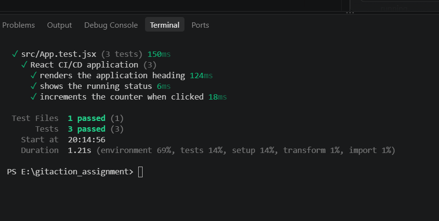
      <br/>
      <b>Figure 1: Test Locally</b>
    </td>
    <td align="center" rowspan="2">
      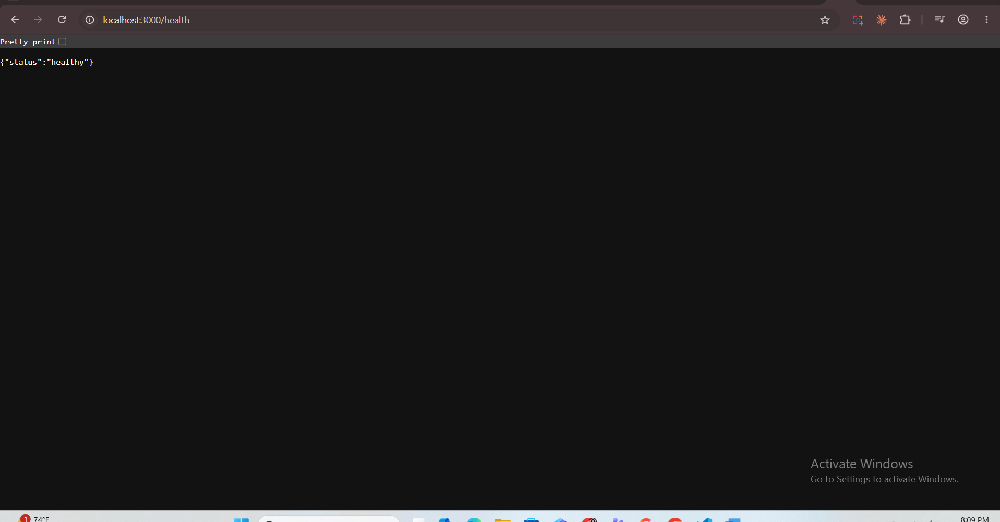
      <br/>
      <b>Figure 3: Checking API Health</b>
    </td>
  </tr>
  <tr>
    <td align="center">
      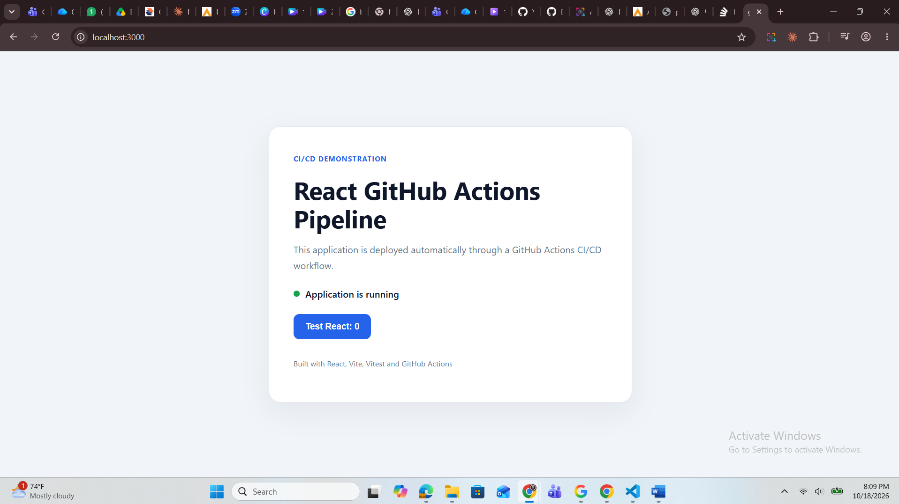
      <br/>
      <b>Figure 2: Frontend</b>
    </td>
  </tr>
</table>


## Pushing on github

```bash

git init
git branch -M main
git add .
git commit -m "Add React application and CI/CD workflow"
git remote add origin https://github.com/Amin-0513/dice_gitaction_assignment.git
git push -u origin main
```
## Screenshot
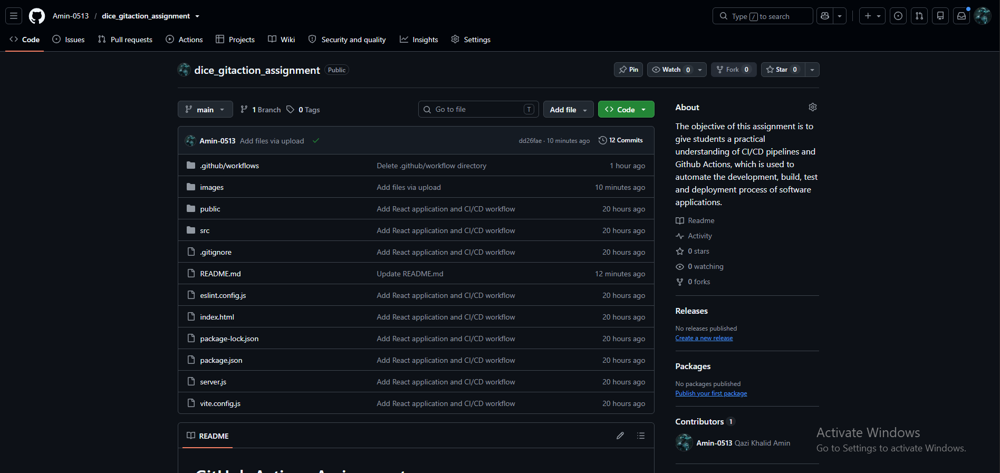

### Deploy on Render

Start on Render’s sign-in page and choose GitHub. GitHub then asks you to authorize Render, which lets Render verify your identity and read your email address. Once you click Authorize, you’re sent to the Render dashboard. Confirm your email on the “Create an account” page and click Create Account. On the dashboard, choose New Web Service, select Git Provider, and connect your GitHub account. Then pick your repo, finish the configuration, and deploy.

## Screenshots

<table>
  <tr>
    <td align="center">
      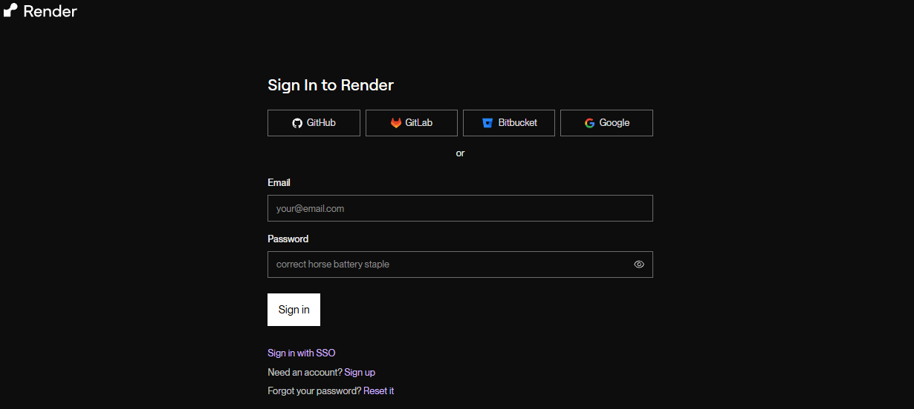
    </td>
    <td align="center">
      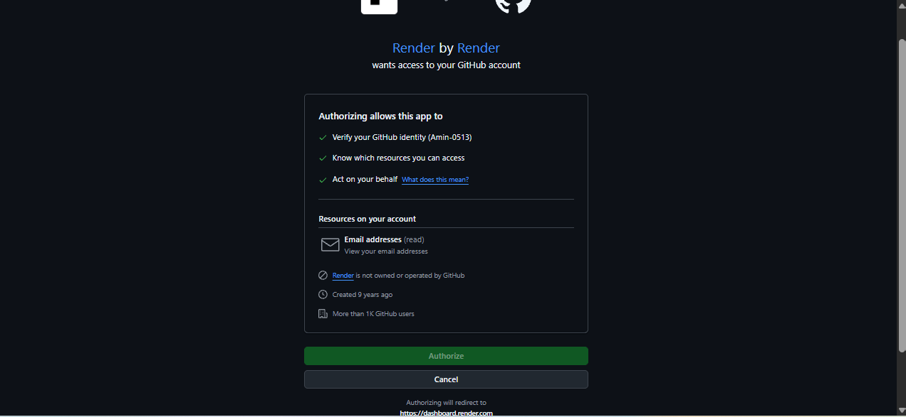
    </td>
    <td align="center">
      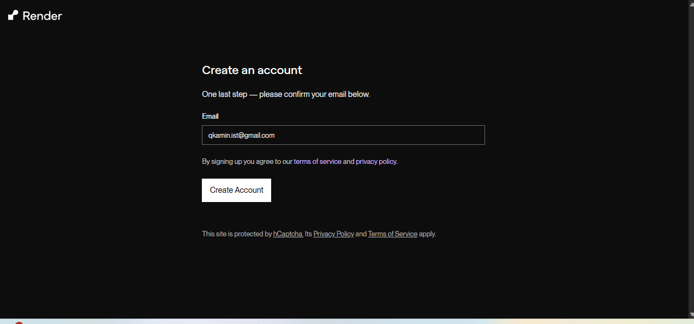
    </td>
  </tr>
  <tr>
    <td align="center">
      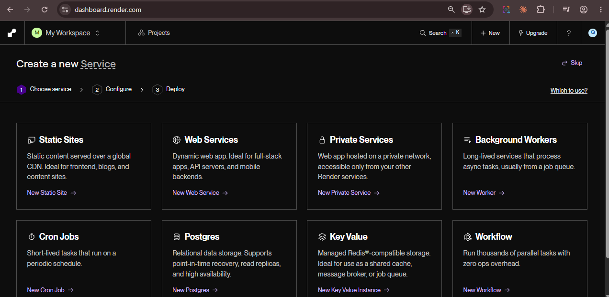
    </td>
    <td align="center">
      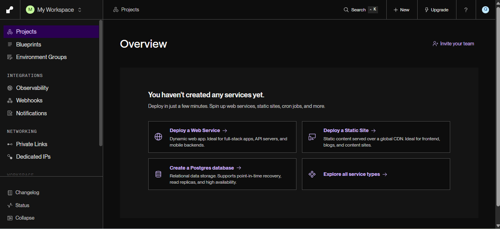
    </td>
    <td align="center">
      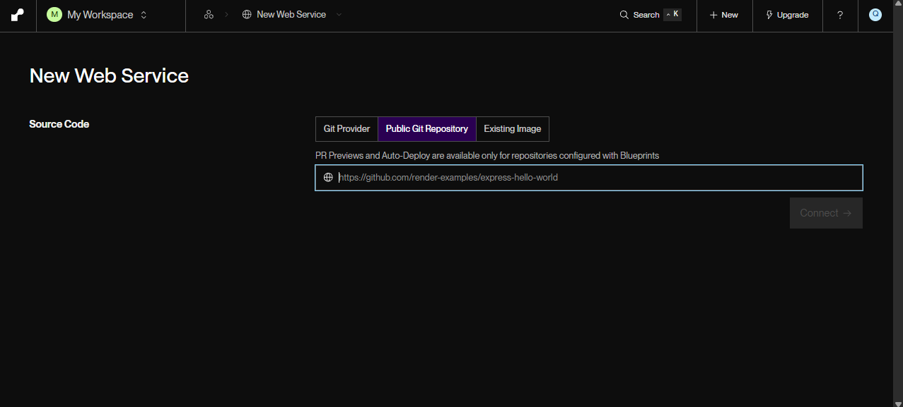
    </td>
  </tr>
</table>

## Deployment on Render
This project deploys the dice_gitaction_assignment Node app from the main branch of the Amin-0513 GitHub repository to Render as a web service. The build step runs npm ci && npm run build to install dependencies and compile the app, then npm start launches it. Render uses the /health path to check that the service is running and responding, so the endpoint should return a successful status once the app is live.

## Configration screenshort

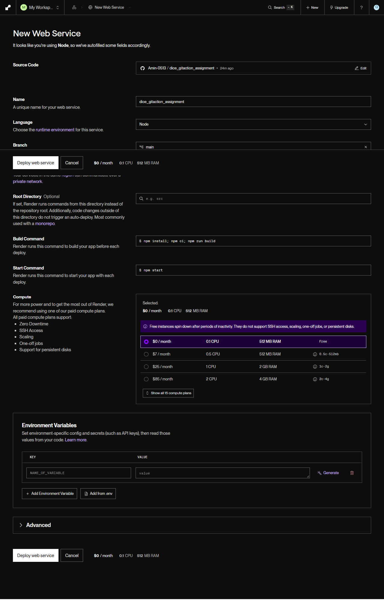


on press deploy button deploying star as shown in following screenshot

<table>
  <tr>
    <td align="center">
      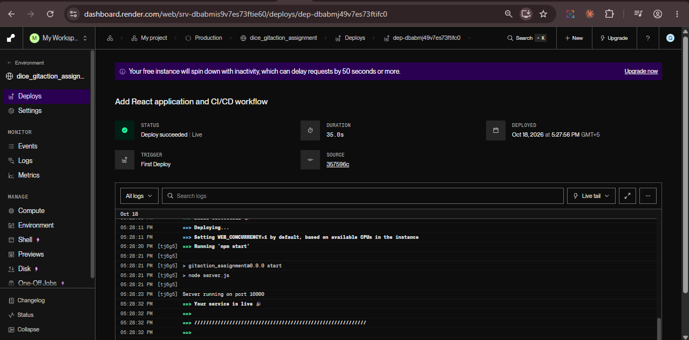
      <br/>
      <b>Figure 1: Render deploy dashboard</b>
    </td>
    <td align="center" rowspan="2">
      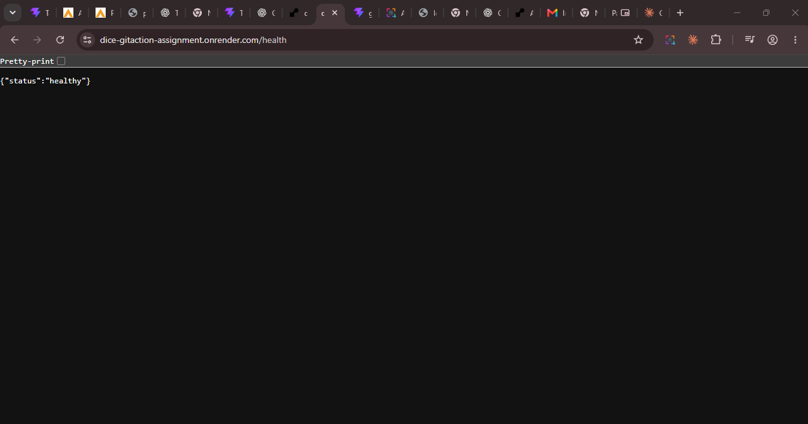
      <br/>
      <b>Figure 3: Checking API Health(Render)</b>
    </td>
  </tr>
  <tr>
    <td align="center">
      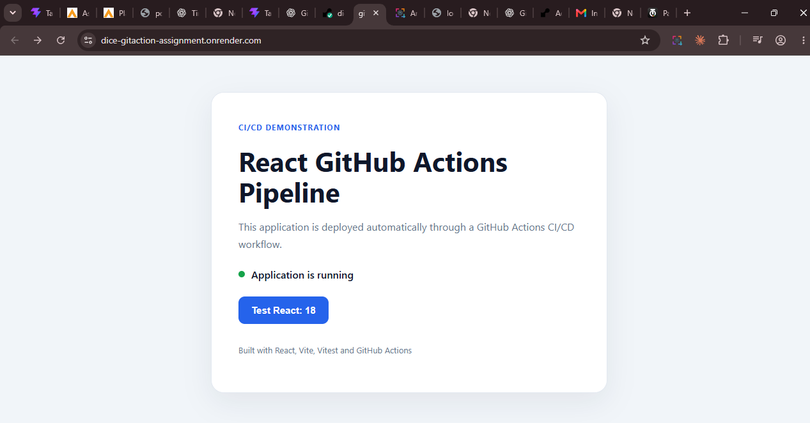
      <br/>
      <b>Figure 2: Render Application Frontend</b>
    </td>
  </tr>
</table>

### Create the github actions

- Before setup github action we must setup deployment secret
** Create the deployment secret**
To connect Render to your GitHub Actions workflow, first open your Render service settings and create a Deploy Hook, then copy the generated URL. Next, go to your GitHub repository and navigate to Settings → Secrets and variables → Actions → New repository secret. Name the secret RENDER_DEPLOY_HOOK_URL and paste the copied Render Deploy Hook URL as its value. Once saved, your workflow can reference this secret to trigger a deployment on Render without exposing the URL in your code.

## Screenshots

<table>
  <tr>
    <td align="center">
      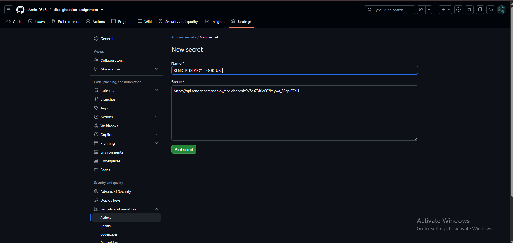
    </td>
    <td align="center">
      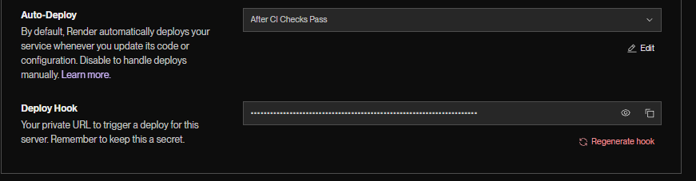
    </td>
  </tr>
</table>


